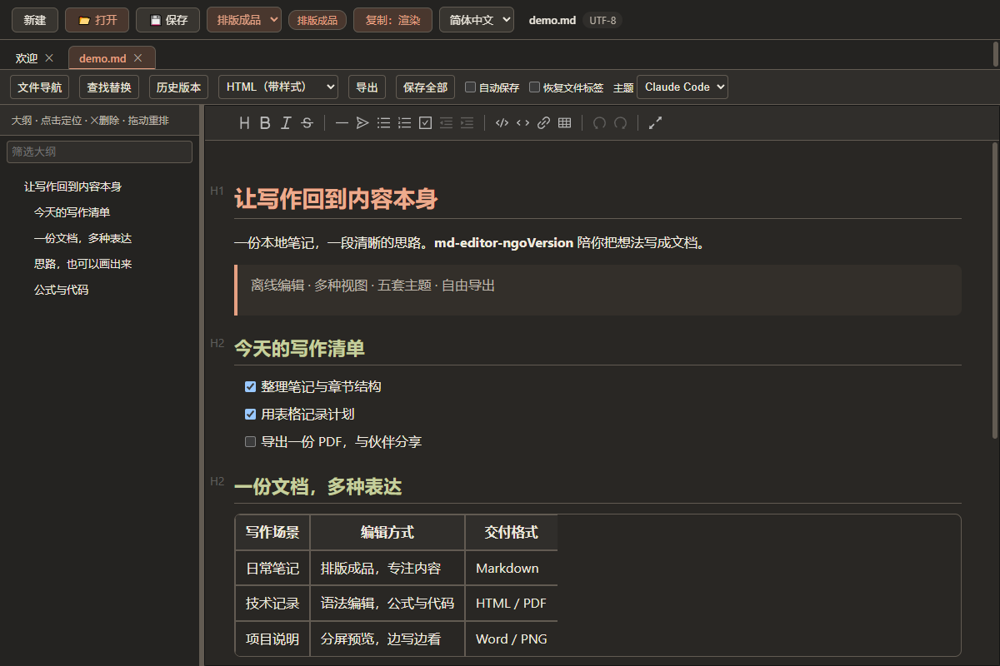
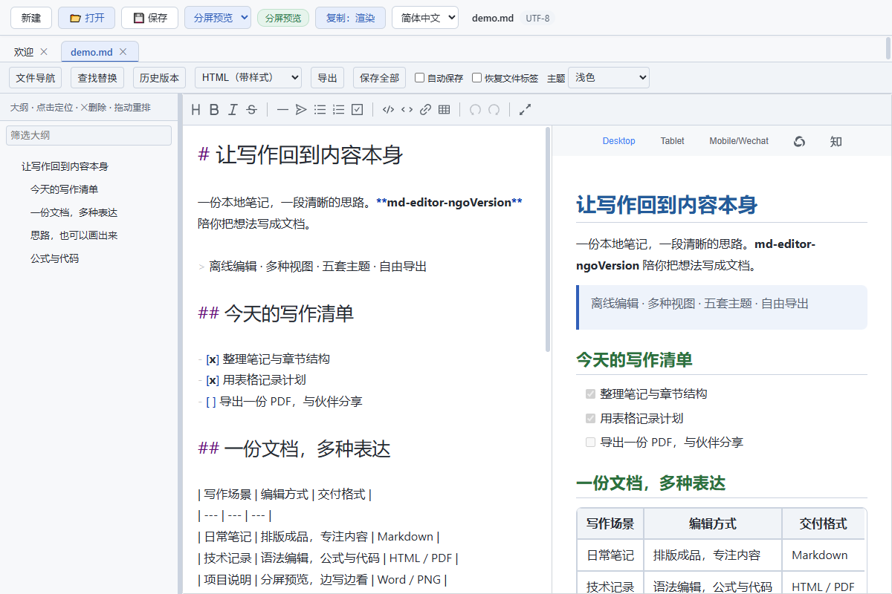
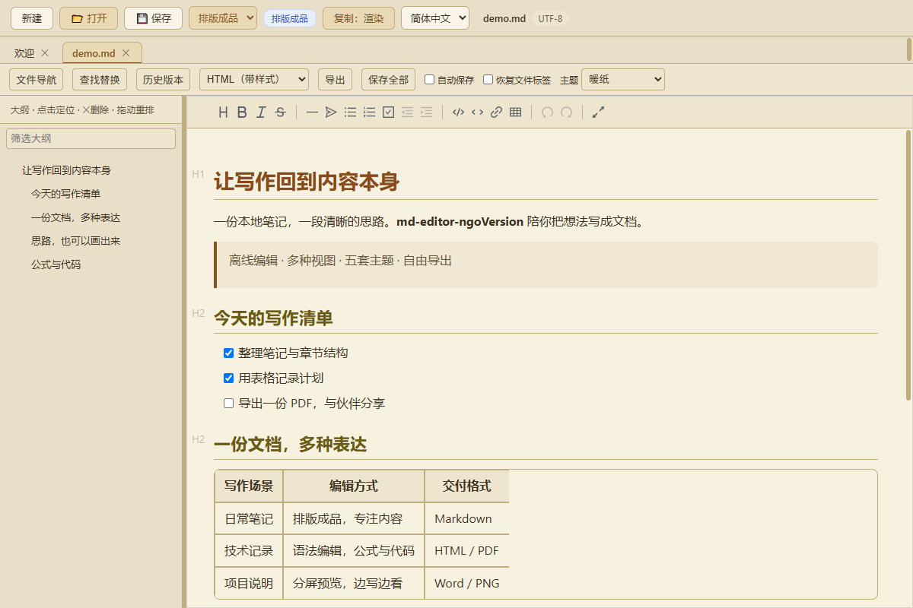

# md-editor-ngoVersion

**本地写作，清晰表达。**

[下载 Windows 版](https://github.com/ngoVictor/md-editor-ngoVersion/releases/latest) · [使用指南](doc/使用指南.md) · [能力边界](doc/能力边界与限制.md) · [反馈问题](https://github.com/ngoVictor/md-editor-ngoVersion/issues)



本项目是 [frandy820/md-editor](https://github.com/frandy820/md-editor) 的个人维护与修改版本，由 [ngoVictor](https://github.com/ngoVictor) 发布。感谢原作者提供开源基础，以及 Tauri、Vditor 和相关开源依赖。原项目版权声明与 MIT 许可证完整保留；本版独立维护，功能与发布节奏以此仓库为准。

面向 Windows 的离线 Markdown 桌面编辑器，使用 Tauri 2、Vditor 3.11 和 TypeScript/Vite。包含五套主题与 MD 图标，版本字段为 0.1.0。

## 原项目提供的基础

原项目已经具备 Markdown 可视化编辑、表格与大纲、多标签、撤销重做、查找替换、公式与图表、图片粘贴、主题、多语言及多格式导出等能力。本版沿用这套基础，并围绕本地写作、资料阅读和文档交付继续改进。

## 本版新增与重点改进

以下既有新增能力，也包含对原有功能的重新整理与完善。

| 功能 | 能做什么 |
| --- | --- |
| **三种编辑视图** | 在“排版成品”中直接写作与编辑表格；用“语法编辑”检查 Markdown 标记；用“分屏预览”同时查看源码和排版结果。切换时保留文档内容与撤销记录。 |
| **标签拖出独立窗口** | 把两个文档放到不同窗口中对照阅读或编辑。未保存内容和撤销记录随标签转移；关闭原窗口后，拆出的窗口仍能使用。 |
| **本地链接与源码预览** | 点击 Markdown 链接打开关联文档并跳到标题；点击源码链接，在独立只读窗口中查看并定位行号，也可指定外部代码编辑器。适合把笔记、项目说明和源码串起来阅读。 |
| **本地图片显示与迁移** | 相对路径图片可在三种视图中显示；粘贴截图后自动插入图片引用。首次保存或跨目录另存为时，复制支持的 Markdown 图片并调整引用，方便连同 assets 文件夹一起搬走。 |
| **文档导出完善** | Word 新后端支持原生列表编号、脚注、中文字体、表格和代码高亮，另保留兼容后端；HTML 可选带样式或纯净输出。PDF、PNG、Word 等输出可包含支持的本地图片及公式、图表静态画面，并统一从格式框导出。 |
| **保存与恢复保护** | 保存前检查磁盘内容变化，避免直接覆盖外部修改；覆盖前归档旧文件。恢复历史时先作为可撤销的未保存修改，检查后再保存。自动保存和恢复文件标签均可按需开启。 |
| **外观与 README 阅读** | 新增 Claude Code 主题与 MD 图标，完善五套主题、六级标题配色及独立预览的外观同步；支持常见 README 的 HTML 标题、对齐容器与在线图片、SVG 徽章显示。 |
| **轻量文件导航** | 从最近文件或选择的文件夹查找资料，按文件名或正文搜索，并可取消搜索；目录浏览保持只读。 |

本版不提供文件删除/重命名、全盘索引、便携 Data 设置或诊断包；标签暂不支持拖回合并。完整操作见[使用指南](doc/使用指南.md)，格式与容量限制见[能力边界](doc/能力边界与限制.md)。

## 边写边看

分屏预览将 Markdown 源码与排版结果放在同一个窗口，适合检查语法、链接与文档结构。



五套主题覆盖不同阅读习惯。首图为 Claude Code 主题，下图为暖纸主题；切换主题不修改正文。



截图来自正式 Windows exe 的 WebView2 界面，使用[公开演示文档](doc/screenshots/demo.md)，不含个人笔记。

## 开始使用

从[本仓库 Releases](https://github.com/ngoVictor/md-editor-ngoVersion/releases/latest) 下载 **md-editor.exe** 即可使用，也可以下载包含许可证的 ZIP 包。程序无需安装，需要 Windows 和 **WebView2 Runtime**；用户数据保存在应用本地数据目录。**上游 Releases 的程序不代表本版功能。** 本次产物校验值和验证范围见[交付记录](doc/资料/维护/MD图标与Claude主题交付-20261110/交付说明.md)。

1. 双击 exe，点击“打开”，或将 Markdown 文件拖入窗口。
2. 默认使用“排版成品”，可直接编辑文字与表格。顶部下拉框或 `Ctrl+Alt+M` 切换模式。
3. `Ctrl+S` 保存，`Ctrl+Shift+S` 另存为；选择辅助栏的格式后点击“导出”，生成其他格式。

| 常用操作 | 入口 |
| --- | --- |
| 撤销 / 重做 | `Ctrl+Z` / `Ctrl+Y` 或 `Ctrl+Shift+Z` |
| 查找 / 替换 | `Ctrl+F` / `Ctrl+H` |
| 快速打开 / 命令 | `Ctrl+P` / `Ctrl+Shift+P` |
| 表格增删与对齐 | 排版成品模式中点击表格，使用浮层工具栏 |
| 拆分窗口 | 至少两个标签时，将其中一个标签拖出窗口 |

自动保存与恢复文件标签默认关闭。恢复标签只记住已保存文件的路径，不备份未保存草稿；历史恢复先生成未保存修改，确认后再手动保存。偏好与历史存于本机应用数据目录，不会跟随 exe 移动。

编辑与本地渲染无需网络、无需登录。Markdown 中的在线图片仍需网络；远程图片及任意 SVG/BMP 不作为本地资源自动嵌入导出。Word 中的公式与图表为静态画面。其他限制见[能力边界](doc/能力边界与限制.md)。

## 开发与构建

需要 Node.js/npm（CI 使用 Node 20）、Rust stable MSVC、Visual Studio C++ 构建工具、Windows SDK 和 WebView2。在项目根运行：

```powershell
git clone https://github.com/ngoVictor/md-editor-ngoVersion.git
cd md-editor-ngoVersion
npm.cmd ci
node scripts/copy-vditor-assets.mjs
node node_modules/@tauri-apps/cli/tauri.js dev
```

打包便携 exe：

```powershell
node node_modules/@tauri-apps/cli/tauri.js build --no-bundle
```

构建产物为 `src-tauri/target/release/md-editor.exe`。target/dist 和测试缓存可以再生成；不影响留存稳定 exe 的离线运行。资源必须由生成脚本准备，不能整目录复制 Vditor。本机根目录留存 exe 不随源码修改更新，也不纳入 Git；GitHub 发布时将已验证的 exe 作为 Release 附件上传。

类型检查、浏览器/Rust 测试、原生验证和 MSVC 环境说明集中在[构建指南](doc/构建exe全流程.md)。维护代码先读 [AGENTS.md](AGENTS.md) 和[架构指南](doc/架构与维护指南.md)。

## 项目目录

| 位置 | 用途 |
| --- | --- |
| src/、src-tauri/ | 前端与 Rust 后端源码、能力配置、图标及依赖锁文件 |
| public/vditor-assets/ | 可生成的离线资源；本机保留供直接开发使用 |
| tests/、scripts/ | 现行自动化回归、资源生成与发布验证 |
| [doc/](doc/README.md) | 现行指南；doc/资料/ 仅保留最新交付证据、正式设计源图及清理记录 |
| orginal_version/ | 本机固定原版参考，Git 忽略，不随仓库发布，不修改 |

MD Editor is an offline Windows Markdown editor with three editing modes, safe local saving, multiple windows, image support, themes, and Word/HTML/PDF/PNG export. See the [documentation index](doc/README.md).

## License

沿用 [MIT License](LICENSE)，保留 `Copyright (c) 2026 frandy820`。本版修改与维护由 ngoVictor 发布，原作者不对本版改动承担维护责任。

第三方依赖、内置字体及渲染资源遵循各自的许可证；本项目的 MIT 声明不替代它们的许可。`package.json` 中的 `private: true` 仅防止误发布到 npm，不影响 GitHub 开源。

欢迎通过 [Issues](https://github.com/ngoVictor/md-editor-ngoVersion/issues) 反馈问题，请附 Windows/WebView2 版本、复现步骤与可公开的最小 Markdown 样例；截图请隐去个人内容。
