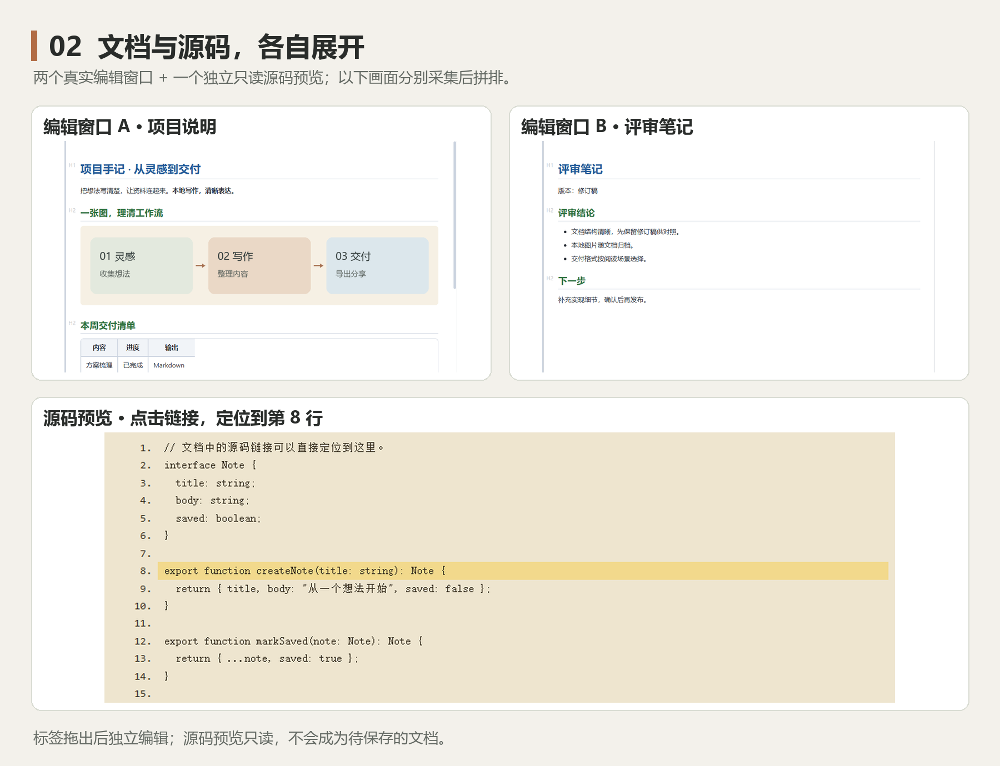
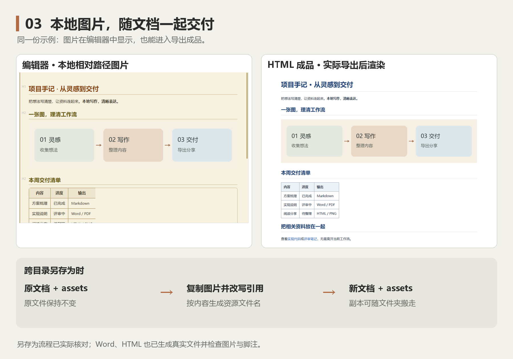
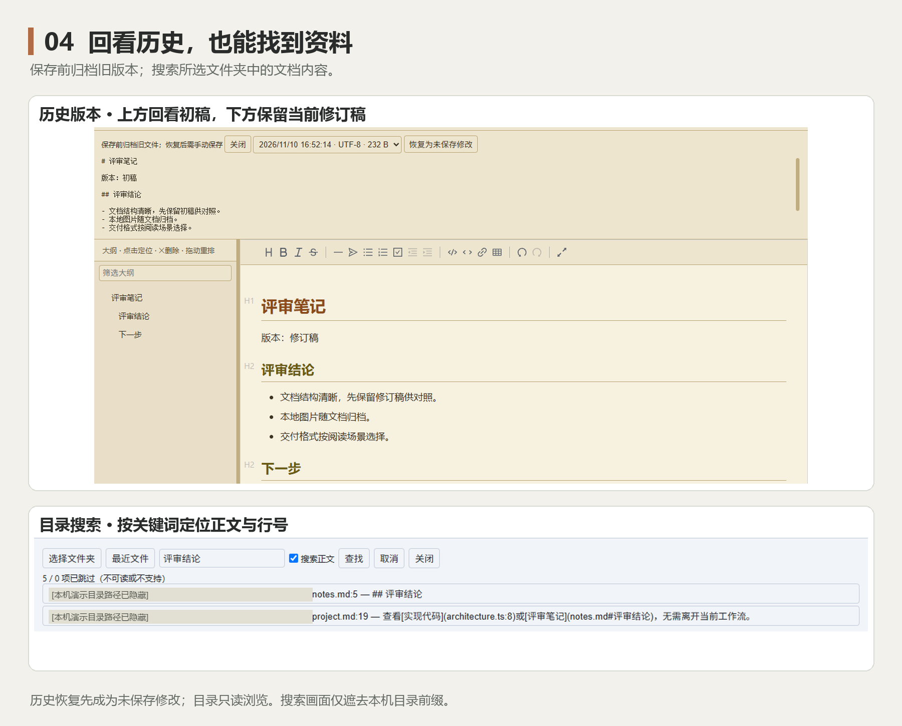
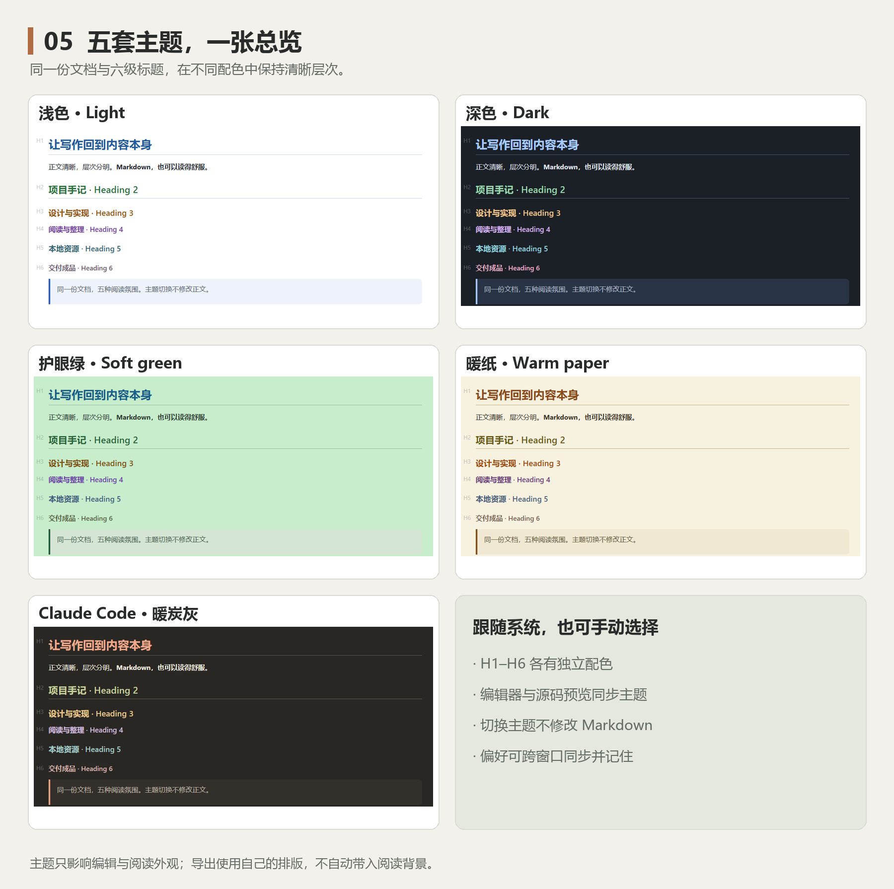

# md-editor-ngoVersion

**本地写作，清晰表达。**

[下载 Windows 版](https://github.com/ngoVictor/md-editor-ngoVersion/releases/latest) · [使用指南](doc/使用指南.md) · [能力边界](doc/能力边界与限制.md) · [反馈问题](https://github.com/ngoVictor/md-editor-ngoVersion/issues)


本项目是 [frandy820/md-editor](https://github.com/frandy820/md-editor) 的个人维护与修改版本，由 [ngoVictor](https://github.com/ngoVictor) 发布。感谢原作者提供开源基础，以及 Tauri、Vditor 和相关开源依赖。原项目版权声明与 MIT 许可证完整保留；本版独立维护，功能与发布节奏以此仓库为准。

面向 Windows 的离线 Markdown 桌面编辑器，使用 Tauri 2、Vditor 3.11 和 TypeScript/Vite。包含五套主题与 MD 图标，版本字段为 0.1.0。

## 原项目提供的基础

原项目已经具备 Markdown 可视化编辑、表格与大纲、多标签、撤销重做、查找替换、公式与图表、图片粘贴、主题、多语言及多格式导出等能力。本版沿用这套基础，并围绕本地写作、资料阅读和文档交付继续改进。

## 本版新增与重点改进

以下既有新增能力，也包含对原有功能的整理与完善。配图使用公开样例，来自正式 Windows exe；相关画面合并展示，可点击放大查看。

### 1. 三种编辑视图，同一份文档自由切换

写作、检查语法、核对排版，可以按当前任务选择视图：

- **排版成品**：直接编辑排版后的内容，点表格即可增删行列、对齐或移动数据行。
- **语法编辑**：保留即时渲染，在编辑位置显示 Markdown 标记，方便调整标题、链接等语法。
- **分屏预览**：左侧写源码，右侧看结果，适合检查图片引用和较复杂的文档结构。

切换视图时保留文档内容与撤销记录；每个标签的撤销互不干扰。


### 2. 标签拖出窗口，文档可以并排处理

需要一边读需求、一边写方案时，把标签拖出编辑器即可形成独立窗口。未保存的内容、撤销记录和阅读位置随标签转移，不必先保存成临时文件。

原窗口关闭后，拆出的窗口仍可继续编辑。至少有两个标签时才能拖出；目前不支持拖回合并。

### 3. 笔记连到源码，点击就能定位

本地 Markdown 链接可以打开另一份文档并跳到指定标题；已有未保存内容的目标文档会保留草稿。源码链接则打开**独立只读预览**，支持行号定位、多开、移动和缩放。

例如在说明中写 `[实现代码](architecture.ts:8)`，就能跳到对应代码行。需要继续修改时，可以指定 VS Code、Notepad++ 等外部编辑器。



### 4. 本地图片可见，另存为时一起搬走

相对路径图片可在三种视图中显示，正文仍保留 Markdown 引用。粘贴截图会写入图片资源，再插入文档。

首次保存或跨目录另存为时，程序会复制支持的 Markdown 图片到目标 `assets`，并调整引用；原文档和原图片保留。整理好后，将文档和它的 `assets` 文件夹一起复制，就能带走这份资料。

### 5. 同一份内容，按用途导出

辅助栏统一选择格式，再点击“导出”，不用在不同入口间寻找。导出使用开始时的文档快照，期间切标签或继续编辑不会串入另一份内容。

- **Word**：新后端支持原生列表编号与脚注、中文字体、表格边框和代码高亮；复杂 HTML 内容也可尝试兼容后端。
- **HTML**：可选带样式或纯净输出，用于独立阅读或继续整理。
- **PDF / PNG / 打印**：用于固定版面分享、图片展示或打开系统打印界面；支持的本地图片、公式与图表可进入成品。

公式与图表在 Word 中是静态画面。导出不会替你保存 Markdown，编辑原稿仍需 `Ctrl+S`。



### 6. 先检查再覆盖，旧版本可以回看

保存时检查磁盘内容是否已被其他程序修改，遇到冲突会提示；覆盖前归档旧文件。选择历史版本后可以先看内容，点“恢复为未保存修改”才带回编辑区，仍可撤销，确认后再手动保存。

自动保存与恢复文件标签都可按需开启，默认关闭。恢复标签只记住有路径的文件，不备份未保存草稿。

### 7. 在选定目录找资料，不建立全盘索引

从最近文件继续工作，或选择一个文件夹浏览内容。可以按文件名查找，也可以搜索正文关键词，结果显示文件与行号，点击后跳转；搜索过程中可取消，超限或跳过文件时会提示。

目录浏览保持只读，适合在笔记目录或项目文件夹中找资料；它不承担文件删除、重命名等管理操作。



### 8. 五套主题集中对照，阅读外观保持一致

新增 **Claude Code** 暖炭灰主题与 MD 图标，并完善浅色、深色、护眼绿、暖纸等配色。H1–H6 各有颜色，编辑器与独立源码预览共享主题；也可以选择跟随系统。

切换主题不重建编辑器，不修改正文或撤销记录；偏好可以跨窗口同步并记住。主题影响编辑与阅读，导出仍使用自己的排版。



常见 README 的 HTML 标题、成对对齐容器、在线图片和 SVG 徽章也可显示，适合直接阅读项目说明；在线图片仍需要网络，不会自动下载到文档目录。

配图使用[项目说明样例](doc/screenshots/examples/project.md)及其关联资料，不含个人笔记；搜索画面仅遮去本机目录前缀。完整操作见[使用指南](doc/使用指南.md)，格式与容量限制见[能力边界](doc/能力边界与限制.md)。本版不提供全盘索引、便携 Data 设置或诊断包。

## 开始使用

从[本仓库 Releases](https://github.com/ngoVictor/md-editor-ngoVersion/releases/latest) 下载 **md-editor.exe** 即可使用，也可以下载包含许可证的 ZIP 包。程序无需安装，需要 Windows 和 **WebView2 Runtime**；用户数据保存在应用本地数据目录。**上游 Releases 的程序不代表本版功能。** 本次产物校验值和验证范围见[交付记录](doc/资料/维护/MD图标与Claude主题交付-20261110/交付说明.md)。

1. 双击 exe，点击“打开”，或将 Markdown 文件拖入窗口。
2. 默认使用“排版成品”，可直接编辑文字与表格。顶部下拉框或 `Ctrl+Alt+M` 切换模式。
3. `Ctrl+S` 保存，`Ctrl+Shift+S` 另存为；选择辅助栏的格式后点击“导出”，生成其他格式。

| 常用操作 | 入口 |
| --- | --- |
| 撤销 / 重做 | `Ctrl+Z` / `Ctrl+Y` 或 `Ctrl+Shift+Z` |
| 查找 / 替换 | `Ctrl+F` / `Ctrl+H` |
| 快速打开 / 命令 | `Ctrl+P` / `Ctrl+Shift+P` |
| 表格增删与对齐 | 排版成品模式中点击表格，使用浮层工具栏 |
| 拆分窗口 | 至少两个标签时，将其中一个标签拖出窗口 |

自动保存与恢复文件标签默认关闭。恢复标签只记住已保存文件的路径，不备份未保存草稿；历史恢复先生成未保存修改，确认后再手动保存。偏好与历史存于本机应用数据目录，不会跟随 exe 移动。

编辑与本地渲染无需网络、无需登录。Markdown 中的在线图片仍需网络；远程图片及任意 SVG/BMP 不作为本地资源自动嵌入导出。Word 中的公式与图表为静态画面。其他限制见[能力边界](doc/能力边界与限制.md)。

## 开发与构建

需要 Node.js/npm（CI 使用 Node 20）、Rust stable MSVC、Visual Studio C++ 构建工具、Windows SDK 和 WebView2。在项目根运行：

```powershell
git clone https://github.com/ngoVictor/md-editor-ngoVersion.git
cd md-editor-ngoVersion
npm.cmd ci
node scripts/copy-vditor-assets.mjs
node node_modules/@tauri-apps/cli/tauri.js dev
```

打包便携 exe：

```powershell
node node_modules/@tauri-apps/cli/tauri.js build --no-bundle
```

构建产物为 `src-tauri/target/release/md-editor.exe`。target/dist 和测试缓存可以再生成；不影响留存稳定 exe 的离线运行。资源必须由生成脚本准备，不能整目录复制 Vditor。本机根目录留存 exe 不随源码修改更新，也不纳入 Git；GitHub 发布时将已验证的 exe 作为 Release 附件上传。

类型检查、浏览器/Rust 测试、原生验证和 MSVC 环境说明集中在[构建指南](doc/构建exe全流程.md)。维护代码先读 [AGENTS.md](AGENTS.md) 和[架构指南](doc/架构与维护指南.md)。

## 项目目录

| 位置 | 用途 |
| --- | --- |
| src/、src-tauri/ | 前端与 Rust 后端源码、能力配置、图标及依赖锁文件 |
| public/vditor-assets/ | 可生成的离线资源；本机保留供直接开发使用 |
| tests/、scripts/ | 现行自动化回归、资源生成与发布验证 |
| [doc/](doc/README.md) | 现行指南；doc/资料/ 仅保留最新交付证据、正式设计源图及清理记录 |
| orginal_version/ | 本机固定原版参考，Git 忽略，不随仓库发布，不修改 |

MD Editor is an offline Windows Markdown editor with three editing modes, safe local saving, multiple windows, image support, themes, and Word/HTML/PDF/PNG export. See the [documentation index](doc/README.md).

## License

沿用 [MIT License](LICENSE)，保留 `Copyright (c) 2026 frandy820`。本版修改与维护由 ngoVictor 发布，原作者不对本版改动承担维护责任。

第三方依赖、内置字体及渲染资源遵循各自的许可证；本项目的 MIT 声明不替代它们的许可。`package.json` 中的 `private: true` 仅防止误发布到 npm，不影响 GitHub 开源。

欢迎通过 [Issues](https://github.com/ngoVictor/md-editor-ngoVersion/issues) 反馈问题，请附 Windows/WebView2 版本、复现步骤与可公开的最小 Markdown 样例；截图请隐去个人内容。
